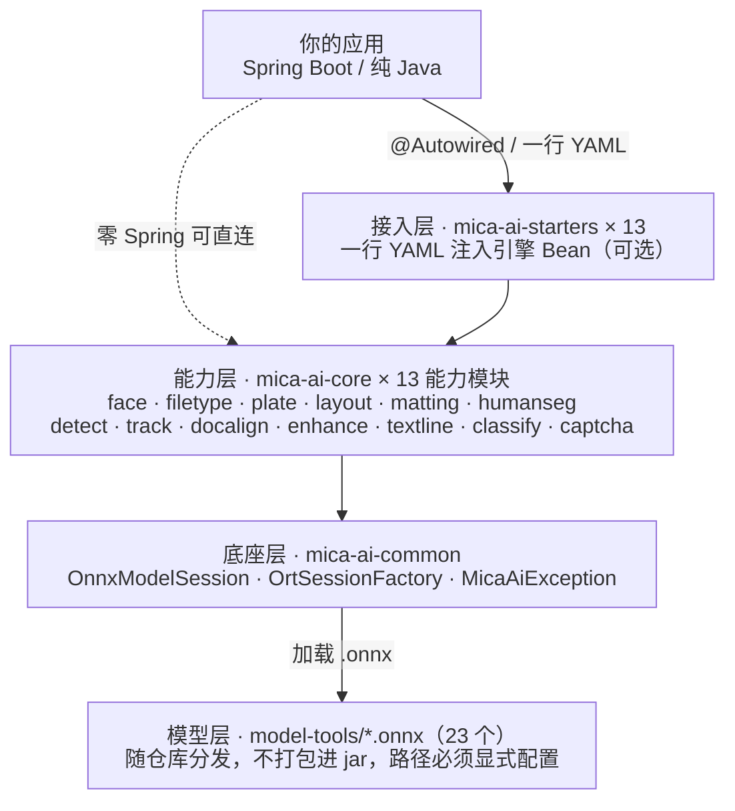

<div align="center">

# 🚀 Mica AI

### 让 Java 工程师也能玩转主流 AI 模型 —— **零 Python · 零 PyTorch · 纯 ONNX Runtime**

[](https://openjdk.org/)
[](https://spring.io/projects/spring-boot)
[](https://onnxruntime.ai/)
[](https://github.com/openpnp/openpnp-vision)
[](LICENSE)
[](https://central.sonatype.com/artifact/net.dreamlu/mica-ai-common/versions)

> 一行依赖，人脸检测 + 128d Embedding + 活体 + 头像 / 证件卡片提取 + 文件类型识别 + 中国车牌识别 + 文档版面分析 + 通用抠图 + 人像分割 + 通用目标检测 + 多目标跟踪 + 文档角点矫正 + 图像超分 + 文本行方向分类 + 通用图像分类 + 通用验证码识别 开箱即用
>
> 给 Java 生态造的"AI 积木"，从此告别在 Java 里调 Python 微服务

[快速开始](#-快速开始) · [整体架构](#-整体架构) · [Spring Boot Starter](#-spring-boot-starter) · [应用场景](#-应用场景) · [更新日志](CHANGELOG.md)

</div>

---

## ✨ 为什么选 Mica AI？

还在为 Java 项目集成 AI 模型苦恼吗？

| 😩 痛点 | ✅ Mica AI 的解法 |
|--------|-----------------|
| Python 微服务部署运维成本高、跨语言调用调试难 | **纯 Java 推理**，JVM 里直接跑，无需任何 Python 进程 |
| PyTorch / PaddlePaddle 几百 MB 起步，包体爆炸 | **ONNX Runtime** 一个 runtime 全部搞定，CPU/GPU/CUDA 自由切换 |
| 模型预处理、后处理各家一套，文档稀烂 | **端到端复刻 OpenCV / Magika / HyperLPR3 实现**，预处理 / 后处理 / 解码全部内置，开箱即用 |
| 集成 Spring Boot 要写一堆 Bean 配置 | **官方 Starter**，一行 YAML 注入引擎 Bean |
| 模型下载慢、上手要跑 Python 脚本 | **模型直接入库**，克隆即用，零下载 / 零转换步骤，配置一次路径即可 |

> 💡 **Mica AI 不是又一个 SDK，而是 Java 工程师的 AI 全家桶。**

---

## 🎯 当前能力一览

| 能力 | 模块 | 核心模型 | 输出维度 / 类别 | License | 商用 |
|------|------|---------|----------------|---------|------|
| 🎭 人脸检测 | `mica-ai-face` | YuNet | 人脸框 + 5 关键点 | Apache 2.0 | ✅ |
| 🧬 人脸特征 | `mica-ai-face` | SFace | **128d** L2 归一化向量 | Apache 2.0 | ✅ |
| 🛡️ 活体检测 | `mica-ai-face` | MiniFASNetV2 | real / replay / print | MIT | ✅ |
| 🖼️ 头像 / 证件卡片提取 | `mica-ai-face` | 几何变换 + USM/CLAHE | 正方形头像 / 矫正卡面 | Apache 2.0 | ✅ |
| 📊 人脸质量评估 | `mica-ai-face` | eDifFIQA-Tiny | 质量分（0~1，越高越好） | **CC-BY-4.0**（分发需署名） | ✅ |
| 😊 表情识别 | `mica-ai-face` | MobileFaceNet（Progressive Teacher） | **7 类**表情 + softmax 置信度 | Apache 2.0 | ✅ |
| 📄 文件类型识别 | `mica-ai-filetype` | Google Magika `standard_v3_3` | **214 类** + mime / group / description | Apache 2.0 | ✅ |
| 🚗 中国车牌识别 | `mica-ai-plate` | HyperLPR3 v20230229 | 车牌号 + 10 类判型 + 颜色 | Apache 2.0 | ✅ |
| 📐 文档版面分析 | `mica-ai-layout` | PP-DocLayoutV3 | **25 类版面区域** + V3 阅读顺序 | Apache 2.0 | ✅ |
| ✂️ 通用抠图 | `mica-ai-matting` | U²-Net 族（`u2netp` 入库 / `u2net` / `u2net_human_seg` 可外置替换） | 原尺寸 alpha 掩码（透明底 / 纯色底 / 二值） | Apache 2.0 | ✅ |
| 👤 人像分割 | `mica-ai-humanseg` | PP-HumanSeg V2-Lite（`192×192` 入库，竖版同族可外置替换） | 原尺寸人像 alpha 掩码（透明底 / 纯色底 / 二值） | Apache 2.0 | ✅ |
| 🎯 通用目标检测 | `mica-ai-detect` | NanoDet-Plus（默认 / 416×416）/ YOLOX-s（640×640） | COCO **80 类** + 置信度 | Apache 2.0 | ✅ |
| 🧭 多目标跟踪 | `mica-ai-track` | ByteTrack（Kalman + 匈牙利匹配，**纯算法零模型**） | 稳定 track id + 轨迹年龄 | MIT | ✅ |
| 📸 文档角点矫正 | `mica-ai-docalign` | DocAligner `lcnet100_h_e_bifpn_256_fp32`（4.55MB 入库，fastvit 同族可外置替换） | 4 个角点（左上 / 右上 / 右下 / 左下）+ 拉平 PNG | Apache 2.0 | ✅ |
| ✨ 图像超分 | `mica-ai-enhance` | Real-ESRGAN `realesr-general-x4v3`（2.33MB 入库，动态尺寸 + tile 推理） | **4 倍**放大后的 PNG / Mat | BSD-3-Clause | ✅ |
| 🔤 文本行方向分类 | `mica-ai-textline` | PP-LCNet_x1_0_textline_ori（`x0_25` 轻量版可外置替换） | **0° / 180°** + softmax 置信度 + 转正角度 | Apache 2.0 | ✅ |
| 🔎 通用图像分类 | `mica-ai-classify` | PaddleClas PULC（4 个入库：整图方向 / 清晰度 / 人物存在 / 表格 6 属性） | **Top-K** + 全量概率（单标签 / 多标签） | Apache 2.0 | ✅ |
| 🔐 通用验证码识别 | `mica-ai-captcha` | ddddocr CRNN + CTC（**8210 类**字符集，模型外置配置） | 验证码文本 + 逐字符置信度 | MIT | ✅ |

## 🏛️ 整体架构

mica-ai 的运行时是四层单向依赖：**接入层 → 能力层 → 底座层 → 模型层**，你的应用站在接入层之上。

<!-- htmlLabels:false 规避 mermaid 在中文标签下的宽度测量误差（foreignObject 测宽按拉丁字体、渲染回退 CJK 字体，导致文字被裁）；wrappingWidth 放大后 <br/> 手写分行才不会被自动折行打散 -->


| 层 | 模块 | 职责 | 关键约束 |
|----|------|------|----------|
| 接入层 | `mica-ai-starters` × 13 | 把 `mica.ai.*` YAML 配置翻译成引擎 Bean | **可选**；不用 Spring Boot 可直接依赖能力层 |
| 能力层 | `mica-ai-core` × 13 | 13 个互不依赖的能力模块，可按需引入 | 零 Spring、纯 Java 8+；`face` 一个模块含 6 项能力 |
| 底座层 | `mica-ai-common` | ONNX 会话工厂、ORT 选项、统一异常 | 被全部能力模块共享 |
| 模型层 | `model-tools/<cap>/models/` | 23 个模型文件（12 个能力目录） | 随仓库分发，**不打包进 jar**，路径必须显式配置 |

> 三条硬约束贯穿全栈：**零 Spring**（core 不引任何 `spring-*`）、**零 Python**（全部 ONNX Runtime 内推理，不 spawn 子进程）、**零模型入 jar**（模型走外置路径配置）。
>
> `mica-ai-example` 提供完整集成示例；相邻项目：[**mica-ppocr**](https://gitee.com/dreamlu/mica-ppocr)（PaddleOCR / PP-OCRv4 的 Java 推理）、[**mica-voice**](https://gitee.com/dreamlu/mica-voice)（ASR / TTS / 热词雷达 / 中文 ITN）。

---

## 🚀 快速开始

### 1️⃣ 添加 Maven 依赖

```xml
<!-- ① 直接用核心引擎（零 Spring） -->
<dependency>
    <groupId>net.dreamlu</groupId>
    <artifactId>mica-ai-face</artifactId>
    <version>${mica-ai.version}</version>
</dependency>

<!-- ② 或使用 Spring Boot Starter（自动注入 Bean） -->
<dependency>
    <groupId>net.dreamlu</groupId>
    <artifactId>mica-ai-face-spring-boot-starter</artifactId>
    <version>${mica-ai.version}</version>
</dependency>
```

其他能力依赖：

```xml
<dependency>
    <groupId>net.dreamlu</groupId>
    <artifactId>mica-ai-filetype</artifactId>          <!-- 文件类型识别 -->
    <version>${mica-ai.version}</version>
</dependency>
<dependency>
    <groupId>net.dreamlu</groupId>
    <artifactId>mica-ai-plate</artifactId>             <!-- 中国车牌识别 -->
    <version>${mica-ai.version}</version>
</dependency>
<dependency>
    <groupId>net.dreamlu</groupId>
    <artifactId>mica-ai-layout</artifactId>            <!-- 文档版面分析（模型 125MB 不随仓库分发） -->
    <version>${mica-ai.version}</version>
</dependency>
<dependency>
    <groupId>net.dreamlu</groupId>
    <artifactId>mica-ai-matting</artifactId>           <!-- 通用抠图（u2netp 4.36MB 随仓库分发；u2net/u2net_human_seg 可外置替换） -->
    <version>${mica-ai.version}</version>
</dependency>
<dependency>
    <groupId>net.dreamlu</groupId>
    <artifactId>mica-ai-humanseg</artifactId>          <!-- 人像分割（PP-HumanSeg V2-Lite 5.88MB 随仓库分发） -->
    <version>${mica-ai.version}</version>
</dependency>
<dependency>
    <groupId>net.dreamlu</groupId>
    <artifactId>mica-ai-detect</artifactId>            <!-- 通用目标检测（NanoDet-Plus 3.62MB / YOLOX-s 34.2MB 随仓库分发） -->
    <version>${mica-ai.version}</version>
</dependency>
<dependency>
    <groupId>net.dreamlu</groupId>
    <artifactId>mica-ai-track</artifactId>             <!-- 多目标跟踪（ByteTrack 纯算法，零模型） -->
    <version>${mica-ai.version}</version>
</dependency>
<dependency>
    <groupId>net.dreamlu</groupId>
    <artifactId>mica-ai-docalign</artifactId>          <!-- 文档角点矫正（DocAligner 4.55MB 随仓库分发） -->
    <version>${mica-ai.version}</version>
</dependency>
<dependency>
    <groupId>net.dreamlu</groupId>
    <artifactId>mica-ai-enhance</artifactId>           <!-- 图像超分（Real-ESRGAN 2.33MB 随仓库分发，4 倍放大 + tile 推理） -->
    <version>${mica-ai.version}</version>
</dependency>
<dependency>
    <groupId>net.dreamlu</groupId>
    <artifactId>mica-ai-textline</artifactId>          <!-- 文本行方向分类（0°/180° 判定 + 转正，模型 6.46MB 随仓库分发） -->
    <version>${mica-ai.version}</version>
</dependency>
<dependency>
    <groupId>net.dreamlu</groupId>
    <artifactId>mica-ai-classify</artifactId>          <!-- 通用图像分类（PULC，4 个模型 4.14–6.79MB 随仓库分发） -->
    <version>${mica-ai.version}</version>
</dependency>
<dependency>
    <groupId>net.dreamlu</groupId>
    <artifactId>mica-ai-captcha</artifactId>           <!-- 通用验证码识别（模型 + 字符集外置配置） -->
    <version>${mica-ai.version}</version>
</dependency>
```

### 2️⃣ 30 秒跑通一个人脸识别（纯 Java）

```java
ModelConfig config = ModelConfig.builder()
    .detectionModelPath(Paths.get("model-tools/face/models/face_detection_yunet_2023mar.onnx"))
    .recognitionModelPath(Paths.get("model-tools/face/models/face_recognition_sface_2021dec.onnx"))
    .build();

try (ModelManager manager = ModelManager.create(config)) {
    FaceDetector detector = new FaceDetector(manager);
    FaceAligner aligner   = new FaceAligner();
    FeatureExtractor extractor = new FeatureExtractor(manager);

    BufferedImage img = ImageIO.read(new File("group.jpg"));
    List<FaceBox> boxes = detector.detect(img);
    for (FaceBox box : boxes) {
        try (Mat aligned = aligner.align(img, box)) {
            float[] feature = extractor.extract(aligned);   // 128d L2 归一化
            // 入库 / 检索交给你自己的向量库（Milvus / pgvector）
        }
    }
}
```

> 模型随仓库分发但**不打包进 jar**，路径必须显式配置（可写绝对路径或 `classpath:` 前缀）；未配置时启动即 fail-fast 并提示指向 `model-tools/face/models/`。

### 3️⃣ 一行配置开启 Spring Boot Starter

```yaml
mica:
  ai:
    face:
      enabled: true                       # 总开关，默认 true
      model:                              # ⚠️ 模型路径统一挂在 model 下
        detection:
          path: model-tools/face/models/face_detection_yunet_2023mar.onnx   # 必填
        recognition:
          path: model-tools/face/models/face_recognition_sface_2021dec.onnx  # 必填
        liveness:
          path: model-tools/face/models/2.7_80x80_MiniFASNetV2.onnx        # liveness.enabled=true 时必填
      detection:
        threshold: 0.9                    # 检测置信度阈值
        nms-threshold: 0.3                # NMS IoU 阈值
      liveness:
        enabled: true                     # 活体开关，默认 true；关闭请显式设 false
        threshold: 0.85
        crop-scale: 2.7
      verify:
        threshold: 0.35                   # 1:1 比对阈值
        strategy: LARGEST_AREA            # 多脸选脸：LARGEST_AREA / LARGEST_SCORE / REJECT
      avatar:
        size: 256
      card:
        output-width: 1011
        output-height: 638
      onnx:
        device: CPU                       # CPU / GPU（枚举）
        intra-op-num-threads: 0           # 0 = ORT 默认
        inter-op-num-threads: 0
        graph-optimization-level: ENABLE_ALL   # DISABLE_ALL / ENABLE_BASIC / ENABLE_EXTENDED / ENABLE_ALL
```

```java
@Service
@RequiredArgsConstructor
public class FaceEnrollService {
    private final FaceDetector detector;            // ← 直接注入
    private final FaceAligner aligner;
    private final FeatureExtractor extractor;       // 128d
    private final LivenessDetector liveness;        // 活体（启用后可用）
    private final FaceVerifier verifier;            // 1:1 比对
    private final AvatarExtractor avatarExtractor;  // 头像提取
    private final CardExtractor cardExtractor;      // 证件卡片提取
}
```

---

## 🧰 Spring Boot Starter

| Starter | 配置前缀 | 一句话能力 |
|---------|---------|----------|
| [mica-ai-face-spring-boot-starter](mica-ai-starters/mica-ai-face-spring-boot-starter/README.md) | `mica.ai.face` | 人脸检测 + 128d 特征 + 活体 + 头像 / 证件卡片提取 |
| [mica-ai-filetype-spring-boot-starter](mica-ai-starters/mica-ai-filetype-spring-boot-starter/README.md) | `mica.ai.filetype` | Google Magika 复刻，214 类文件类型识别（含 / 排除置信度三模式） |
| [mica-ai-plate-spring-boot-starter](mica-ai-starters/mica-ai-plate-spring-boot-starter/README.md) | `mica.ai.plate` | HyperLPR3 中国车牌识别（检测 + CRNN 识别 + 颜色分类 + 10 类判型） |
| [mica-ai-layout-spring-boot-starter](mica-ai-starters/mica-ai-layout-spring-boot-starter/README.md) | `mica.ai.layout` | PP-DocLayoutV3 文档版面分析（25 类 + V3 阅读顺序；模型 125MB 不随仓库分发，需本地放模型） |
| [mica-ai-matting-spring-boot-starter](mica-ai-starters/mica-ai-matting-spring-boot-starter/README.md) | `mica.ai.matting` | U²-Net 族通用抠图（透明底 / 纯色底 / 二值掩码；`u2netp` 4.36MB 入库，`u2net` / `u2net_human_seg` 走 `model-path` 外置切换） |
| [mica-ai-humanseg-spring-boot-starter](mica-ai-starters/mica-ai-humanseg-spring-boot-starter/README.md) | `mica.ai.humanseg` | PP-HumanSeg V2-Lite 人像分割（透明底 / 纯色底 / 二值掩码；`192×192` 5.88MB 入库，竖版同族走 `model-path` 外置切换） |
| [mica-ai-detect-spring-boot-starter](mica-ai-starters/mica-ai-detect-spring-boot-starter/README.md) | `mica.ai.detect` | NanoDet-Plus / YOLOX-s 通用目标检测（COCO 80 类；两种模型族切换只改 `family` + `input-size`） |
| [mica-ai-track-spring-boot-starter](mica-ai-starters/mica-ai-track-spring-boot-starter/README.md) | `mica.ai.track` | ByteTrack 多目标跟踪（纯算法零模型，输入任意检测框序列，输出稳定 track id） |
| [mica-ai-docalign-spring-boot-starter](mica-ai-starters/mica-ai-docalign-spring-boot-starter/README.md) | `mica.ai.docalign` | DocAligner 文档角点检测 + 透视矫正（4 角点 + 一键拉平；4.55MB 入库，fastvit 同族走 `model-path` 外置切换） |
| [mica-ai-enhance-spring-boot-starter](mica-ai-starters/mica-ai-enhance-spring-boot-starter/README.md) | `mica.ai.enhance` | Real-ESRGAN 4 倍图像超分（2.33MB 入库；大图自动 tile 切分，`tile-size` / `tile-overlap` 可调） |
| [mica-ai-textline-spring-boot-starter](mica-ai-starters/mica-ai-textline-spring-boot-starter/README.md) | `mica.ai.textline` | PP-LCNet 文本行方向分类（0° / 180° 判定 + 转正；`x1_0` 6.46MB 入库，`x0_25` 轻量版走 `model-path` 外置切换） |
| [mica-ai-classify-spring-boot-starter](mica-ai-starters/mica-ai-classify-spring-boot-starter/README.md) | `mica.ai.classify` | PaddleClas PULC 通用图像分类（整图方向 / 清晰度 / 人物存在 / 表格 6 属性；`labels-path` 必填，多模型分别声明 Bean） |
| [mica-ai-captcha-spring-boot-starter](mica-ai-starters/mica-ai-captcha-spring-boot-starter/README.md) | `mica.ai.captcha` | ddddocr 通用验证码识别（CRNN + CTC，8210 类字符集；**模型与字符集外置配置**，`model-path` / `charset-path` 必填） |

只需在 `application.yml` 配好模型路径，对应 Bean 即可 `@Autowired` 直接用。

---

## 🏗️ 项目结构

```
mica-ai/
├── pom.xml                         # 顶层 BOM（revision / spring-boot / onnxruntime）
├── mica-ai-core/                   # 核心引擎（零 Spring，纯 Java 8+）
│   ├── mica-ai-common/             #   🧩 ONNX 通用基础设施、统一异常
│   ├── mica-ai-face/               #   🎭 OpenCV Zoo 人脸识别
│   ├── mica-ai-filetype/           #   📄 Google Magika 文件类型识别
│   ├── mica-ai-plate/              #   🚗 HyperLPR3 中国车牌识别
│   ├── mica-ai-layout/             #   📐 PP-DocLayoutV3 文档版面分析
│   ├── mica-ai-matting/            #   ✂️ U²-Net 族通用抠图
│   ├── mica-ai-humanseg/           #   👤 PP-HumanSeg 人像分割
│   ├── mica-ai-detect/             #   🎯 NanoDet-Plus / YOLOX-s 通用目标检测
│   ├── mica-ai-track/              #   🧭 ByteTrack 多目标跟踪（纯算法零模型）
│   ├── mica-ai-docalign/           #   📸 DocAligner 文档角点检测 + 透视矫正
│   ├── mica-ai-enhance/            #   ✨ Real-ESRGAN 4 倍图像超分（tile 推理）
│   ├── mica-ai-textline/           #   🔤 PP-LCNet 文本行方向分类（0° / 180°）
│   ├── mica-ai-classify/           #   🔎 PaddleClas PULC 通用图像分类
│   └── mica-ai-captcha/            #   🔐 ddddocr 通用验证码识别（CRNN + CTC）
├── mica-ai-starters/               # Spring Boot 2 Starter：每个能力一个（mica-ai-<cap>-spring-boot-starter），见上方 Starter 表
├── mica-ai-example/                # Spring Boot 集成示例
└── model-tools/                    # 模型资产：12 个能力目录 / 23 个 .onnx，随仓库分发、不打包进 jar（体积为目录合计，单文件 <50MB）
    ├── face/models/                #   5 个模型 · 50.3MB · ✅ 入库
    ├── filetype/models/            #   1 个模型 + 配置 · 3.1MB · ✅ 入库
    ├── plate/models/               #   4 个模型 · 17.3MB · ✅ 入库
    ├── layout/models/              #   1 个模型 · 124.5MB · ⚠️ 不随仓库分发
    ├── matting/models/             #   1 个模型 · 4.4MB · ✅ 入库
    ├── humanseg/models/            #   1 个模型 · 5.9MB · ✅ 入库
    ├── detect/models/              #   2 个模型 · 37.8MB · ✅ 入库
    ├── docalign/models/            #   1 个模型 · 4.5MB · ✅ 入库
    ├── enhance/models/             #   1 个模型 · 2.3MB · ✅ 入库（含 BSD-3 许可证原文）
    ├── textline/models/            #   1 个模型 · 6.5MB · ✅ 入库
    ├── classify/models/            #   4 个模型 + label_list · 23.3MB · ✅ 入库
    └── captcha/models/             #   1 个模型 + 字符集 · 13.0MB · ✅ 入库
```

---

## 🛠️ 环境和依赖

| 组件 | 版本 | 说明 |
|------|------|------|
| ☕ JDK | **8+** | 推荐 Temurin / Azul Zulu 8、11、17 |
| 📦 Maven | 3.6+ | 构建 / 打包 |
| 🧠 ONNX Runtime | 1.18.0 | Maven 自动拉取，CPU/GPU 可选 |
| 🖼️ OpenCV | 4.9.0（openpnp） | Maven 自动拉取对应系统 / 架构的原生库 |

> GPU 加速：把 `onnxruntime` 替换为 `onnxruntime_gpu`，并将 `device=gpu`（需 CUDA Toolkit + 驱动）。

---

## 🗺️ 应用场景

| 场景 | 推荐组合 |
|------|---------|
| 🎭 **人脸识别 / 门禁 / 考勤** | `mica-ai-face` + Milvus / pgvector（向量库做 1:N 检索） |
| 🪪 **证件核验 / 人证合一** | `mica-ai-face` 的 `FaceVerifier` + `CardExtractor` |
| 🖼️ **头像 / 证件卡片标准化** | `mica-ai-face` 的 `AvatarExtractor` / `CardExtractor` |
| 📄 **任意文件 MIME 推断 / 内容审计** | `mica-ai-filetype` — 214 类 + 三种置信度模式 |
| 🚗 **停车场 / 道闸 / 智慧出行** | `mica-ai-plate` 的 `PlatePipeline` + 颜色分类兜底 |
| 📐 **PDF / 文档预处理 / 阅读顺序** | `mica-ai-layout` 的 `LayoutPipeline` — 25 类版面 + V3 阅读顺序 |
| ✂️ **商品图 / 人像去背 / 证件照换底** | `mica-ai-matting` 的 `MattingEngine` — 透明底 PNG / 纯色底合成 / 二值掩码 |
| 👤 **直播 / 短视频人像抠像 / 绿幕替代** | `mica-ai-humanseg` 的 `HumanSegEngine` — 人像专用语义分割，`192×192` 输入，透明底 / 纯色底一键输出 |
| 🎯 **通用物体检测 / 视频结构化** | `mica-ai-detect` 的 `DetectEngine` + `mica-ai-track` 的 `ByteTracker` — 检测框 + 稳定 track id 组成最小可用流水线 |
| 📸 **手机拍文档 / 扫描件摆正** | `mica-ai-docalign` 的 `DocAlignEngine` — 4 角点检测 + 透视拉平，接 `mica-ai-layout` / `mica-ppocr` 前先摆正 |
| ✨ **低清图 / 缩略图放大** | `mica-ai-enhance` 的 `EnhanceEngine` — 4 倍超分，大图走 tile 推理；适合头像、商品图、证件照清晰化 |
| 🔤 **OCR 前置转正 / 扫描件倒置行纠正** | `mica-ai-textline` 的 `TextLineEngine` — 单行 0° / 180° 判定 + `uprightBytes` 一键转正（配合 `mica-ppocr` 做文本行定位） |
| 🔎 **图像质量门控 / 整图方向 / 表格结构判定** | `mica-ai-classify` 的 `ClassifyEngine` — 通用 N 类 / 多标签分类底座，PULC 首批 4 模型（整图方向 / 清晰度 / 人物存在 / 表格 6 属性）已入库 |
| 🔐 **验证码自动识别 / 自动化测试填码** | `mica-ai-captcha` 的 `CaptchaEngine` — 文本 + 逐字符置信度，低置信度可转人工 |

> 以上是**单能力**场景。多个能力编排成完整业务链路的组合示例见
> [`mica-ai-example`](mica-ai-example/README.md)：
>
> | 组合场景 | 能力链路 |
> |---------|---------|
> | 📄 **智能文档流水线**（手机拍文档 → 可读结构化） | `docalign` 拉正 → `classify` 整图方向 → `layout` 版面/阅读顺序 → `textline` 文本块转正 → `enhance` 超分 |
> | 🪪 **证件照一键生成**（随手拍 → 合规证件照） | `face` 检人脸 → `face` 质量评估 → `matting`/`humanseg` 抠像换底 → 按规格裁剪 → `enhance` 超分 |

---

## 📄 License

本项目基于 [Apache License 2.0](LICENSE) 协议开源，可放心用于商业项目；当前所有依赖模型均确认可商用（详见 `AGENTS.md` §6.1）。

> ⚠️ 唯一非 Apache 的依赖模型是 **eDifFIQA-Tiny（CC-BY-4.0）**：允许商用，但**再分发时必须保留署名与许可声明**（详见 [`model-tools/face/README.md`](model-tools/face/README.md) 与 [NOTICE](NOTICE)）。

---

## 💖 致谢

感谢所有为 Mica 系列项目做出贡献的开发者，以及以下开源项目：

- [OpenCV Zoo](https://github.com/opencv/opencv_zoo) · [minivision Silent-Face-Anti-Spoofing](https://github.com/minivision-ai/Silent-Face-Anti-Spoofing) · [ONNX Runtime](https://onnxruntime.ai/) · [openpnp/openpnp-vision](https://github.com/openpnp/openpnp-vision) · [Google Magika](https://github.com/google/magika) · [HyperLPR3](https://github.com/szad670401/HyperLPR) · [PaddleOCR](https://github.com/PaddlePaddle/PaddleOCR) · [PaddleClas](https://github.com/PaddlePaddle/PaddleClas) · [PaddleX](https://github.com/PaddlePaddle/PaddleX) · [U²-Net](https://github.com/xuebinqin/U-2-Net) · [DocAligner](https://github.com/DocsaidLab/DocAligner) · [Real-ESRGAN](https://github.com/xinntao/Real-ESRGAN) · [ByteTrack](https://github.com/FoundationVision/ByteTrack) · [ddddocr](https://github.com/sml2h3/ddddocr)
- 已抽离的 Mica 系列仓库：[mica-ppocr](https://gitee.com/dreamlu/mica-ppocr) · [mica-voice](https://gitee.com/dreamlu/mica-voice)

<div align="center">

**[⬆ 回到顶部](#-mica-ai)** · Made with ❤️ by [Mica Team](https://www.dreamlu.net)

</div>